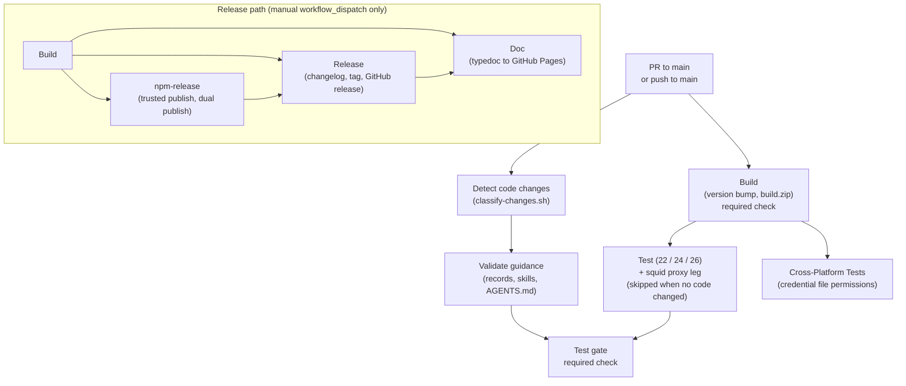

# Frodo Library Release Pipeline

The Frodo Library project uses an automated release pipeline defined in [../.github/workflows/pipeline.yml](../.github/workflows/pipeline.yml).

For the tools underneath the pipeline — bundler, the axios dts postinstall
patch, the TypeScript version policy, lint, and the maintenance history of
the build environment — see [BUILD-ENV.md](BUILD-ENV.md).

The pipeline diagram below is rendered by GitHub from the Mermaid source in
this file — it updates with the workflow itself and never goes stale like a
screenshot. (In renderers without Mermaid support, the same layout is
described in the job sections that follow.)



## Release Model

### Triggers

The workflow runs on:

- **Pull requests to `main`** — build + test validation. Release jobs are
  skipped.
- **Pushes to `main`** — build + test validation. No publishing, no release.
  A push that changes only files the classifier calls non-code (documentation,
  guidance files, `pipeline.yml`, the Issue Concierge's files) does not start
  the workflow (the `paths-ignore` of the push trigger, see "Detect code
  changes").
- **Manual `workflow_dispatch`** — with the default release type `ci-only`,
  the validation of a push to `main` and nothing else (see
  [Full CI by hand](#full-ci-by-hand)); with an explicit release type, the full
  release flow.

### Full CI by hand

A pull request that changes no code skips the long test jobs, and a push that
changes only ignored files starts no run (see "Detect code changes"). To run
the whole validation anyway, for a pull request branch or for `main`, dispatch
the workflow with the release type `ci-only`, which is also the preselected
choice:

```console
gh workflow run pipeline.yml -R rockcarver/frodo-lib --ref <branch> -f release-type=ci-only -f dry-run=false
gh run list -R rockcarver/frodo-lib --workflow pipeline.yml --event workflow_dispatch --limit 1
```

The run does what a push to `main` does: Build, the Node 22, 24 and 26 tests,
the cross-platform tests and the gates. It never reaches the version bump, the
release preflight, `npm-release`, `Release` or `doc`: every job and step that
exists only for a dispatch skips when the type is `ci-only`, and
`src/pipelineWorkflow.test.ts` fails if one loses that guard. Because `ci-only`
is the default, a dispatch that does not name a release type publishes
nothing; the release skill always passes the type.

### Release Type Selection

Releases are explicit. Maintainers choose the release type from workflow input
(or `ci-only`, which releases nothing):

- `prerelease`
- `premajor` — starts (or continues) an `X.0.0-1` prerelease train for the next major
- `patch`
- `minor`
- `major`

There is no label-based or phrase-based bump logic in this pipeline.

### Dry Run Support

Manual runs include `dry-run`:

- `true`: computes versions and runs release logic without publishing, tagging, or creating GitHub releases
- `false`: performs the full release flow

A dry run needs a release type: with `ci-only` no release job runs, so there
is nothing to rehearse.

### Branch protection

The `main-branch-protection` ruleset requires three checks before anything
merges to `main`:

- `Build`
- `Test gate`
- `Cross-Platform Tests (Credential File Permissions)`

Release bot commits to `main` (changelog/version/docs updates) are covered
by the ruleset's bypass: the Release job authenticates with the org-wide
`FRODO_CI_PAT` fine-grained token (repository admin identity), whose pushes
the admin bypass admits. The GitHub Actions app cannot be a bypass actor —
`GITHUB_TOKEN` pushes to `main` are rejected by the required status checks.

## Jobs

### Detect code changes

`Detect code changes` runs first on every event. For pull requests it lists the
changed files through the API (a renamed file under both names) and hands the
list to [`.github/scripts/classify-changes.sh`](.github/scripts/classify-changes.sh),
which prints two results:

- `code=false` only when **every** file is on the non-code list: root `*.md`,
  `docs/`, `LICENSE`, `decisions/`, `.claude/skills/`, and under `.github/`
  the issue templates, the Issue Concierge's folder `issue-concierge/` and pin `issue-concierge.yml`, `aw/`,
  `instructions/`, `scripts/`, every workflow file except `pipeline.yml`,
  `CODEOWNERS`, `dependabot.yml` and `copilot-instructions.md`. Anything else
  counts as code, including `package.json`, the lockfile, `scripts/`, `src/`,
  `pipeline.yml` and the classifier itself. API errors, more than 3000
  changed files, a missing classifier, pushes, `workflow_dispatch` and
  release runs all resolve to `code=true`, so the filter can only ever skip
  work, never hide it.
- `guidance=true` when a file changed that a validation test reads (see
  [Validate guidance](#validate-guidance)): `decisions/`, `.claude/skills/`,
  `.github/instructions/`, the core records drift check
  (`.github/scripts/check-core-records-drift.mjs`) and its workflow, or any
  Markdown file in the repository root. It is independent of `code`.

The script is read from the commit the pull request **targets**, never from
the pull request itself: a change to the classifier is classified by the
version on `main`, which counts the script as code. The pull request that adds
or changes the script therefore always runs the full suite, and its fixture
test (`src/classifyChanges.test.ts`) runs in it. The job holds only
`contents: read` and `pull-requests: read`.

When `code=false`, `Test` and `Cross-Platform Tests` are skipped. `Build` still runs (it is a
required check and also lints and builds). Skipped required jobs count as
passing, and the gate job(s) accept a skip only when `code=false` and `Build`
succeeded. Filtering cannot use `paths-ignore` on the `pull_request` trigger,
because required checks would stay "expected" forever. The rules are decided in
[core 0012](decisions/core/0012-merging-is-gated-by-a-stable-set-of-required-checks.md)
and [core 0016](decisions/core/0016-changes-that-are-not-code-still-run-the-checks-that-validate-them.md);
the procedure for changing them is the skill
[change-the-ci-pipeline](.claude/skills/change-the-ci-pipeline/SKILL.md).

**The push trigger.** `Detect code changes` only looks at pull requests; a push
always counts as code. So a merge whose pull request skipped the tests would
start everything again. The `paths-ignore` of the push trigger (a pull request
cannot use it, see above) avoids that for the files the classifier calls
non-code:

- documentation: `docs/`, `README.md`, `CONTRIBUTE.md`, `PIPELINE.md`,
  `CODE_OF_CONDUCT.md`, and every other Markdown file in the repository root
  (`AGENTS.md`, `CLAUDE.md`, `BUILD-ENV.md`, ...);
- `LICENSE`, the decision records in `decisions/` and `.claude/skills/`;
- under `.github/`: `instructions/`, `ISSUE_TEMPLATE/`, `CODEOWNERS`,
  `dependabot.yml` and `copilot-instructions.md`;
- the Issue Concierge's files: its pin `.github/issue-concierge.yml`, its folder
  `.github/issue-concierge/`, `.github/aw/`, and the scripts
  (`.github/scripts/*.mjs`) and workflow definitions (`.github/workflows/*.yml`
  and `*.md`) it installs. Those patterns also cover this repository's own core
  records drift check (`check-core-records-drift.mjs`,
  `core-records-drift.yml`).

Most of these are guidance files that a test reads (`decisions/`, the Markdown
files of the root, `.claude/skills/`, `.github/instructions/`, the drift
check). A pull request that changes them runs the fast `Validate guidance` job;
the push after the merge does not repeat it. `pipeline.yml` is on the list too,
although the classifier counts it as code: a pull request that changes it runs
everything, and the push after its merge does not. The classifier itself
(`classify-changes.sh`) and files in deeper folders (other than a nested
`README.md`) are not on the list: their push still runs everything.
`src/pipelineWorkflow.test.ts` checks that nothing is ignored on push that the
classifier counts as code. The list is allowed to be narrower than the
classifier's, never wider. To run everything for a push that was skipped, see
[Full CI by hand](#full-ci-by-hand).

### Validate guidance

`Validate guidance` runs when the classifier says `guidance=true`, also when
the long test matrix is skipped. It installs dependencies (no build) and runs
only the tests that validate files the filter treats as non-code:

- `src/agentSkills.test.ts`: every skill in `.claude/skills/`, the files and
  scripts it cites, `AGENTS.md`;
- `src/decisionRecords.test.ts`: every record in `decisions/` and in
  `decisions/core/` (the core records, with their index), the weekly core
  records drift check and its workflow (`core-records-drift.yml`, which only
  reads and compares `decisions/core/` with frodo-cli's);
- `src/index.test.ts`: the contributor guide the export guard points at.

A code change runs the same tests again in the full suite, so this job only
gives the answer sooner. `src/pipelineWorkflow.test.ts` fails when a test that
reads a guidance file is missing from the job's list; the path list it
implies is `GUIDANCE` in the classifier. A pull request that adds a new kind
of validated file adds its path to the classifier in the same pull request.
Known limit: a skill may cite any file in the repository, and a non-code pull
request that renames or deletes a cited file outside the guidance paths (for
example a workflow file) is only caught when the next code change runs the
full suite.

### Build

Build does the following:

- Uses deep checkout with tags (`fetch-depth: 0`, `fetch-tags: true`)
- Computes next version with `gearsnlevers/version-bump-action@v1` (manual release runs)
- Updates manifests with `gearsnlevers/manifest-version-update-action@v1` (manual release runs)
- Runs `npm run check` (ESLint 10 + Prettier, including import order) and a
  critical-level security audit (check only: it fails the build on a critical
  advisory and never rewrites the lockfile)
- Builds library + docs and uploads `build.zip`

### Test

- **Test (22 / 24 / 26)**: the full jest suite (153 suites, 2,433 tests,
  927 snapshots) on each supported Node version, with a squid proxy service
  container: direct tests run normally, proxy tests run through the proxy,
  and a proxy leg failure triggers the diagnostic retry steps.
- **Cross-Platform Tests (Credential File Permissions)**: verifies the
  library creates credential files with restrictive permissions on Windows,
  macOS and Linux.

### Test gate

`Test gate` is a tiny aggregator job that runs after the `Test` matrix and
fails if **any** matrix leg failed. It exists because of how branch
protection works: the ruleset must name required checks exactly, and the
required-check name of a matrix job includes its matrix value
(`Test (22)`, `Test (24)` …). If the ruleset named those directly, every
Node version added or retired would require a ruleset edit. Instead the
ruleset requires the single, stable name `Test gate`, whose outcome is
derived from the whole matrix — so the Node version list can change freely
without ever touching repository settings.

The job uses `if: ${{ !cancelled() }}` so it still runs (and fails) when a
matrix leg is cancelled or skipped, which a plain `needs` alone would
silently accept. A skip is only accepted when `Detect code changes` reported
`code=false` and `Build` succeeded; otherwise the gate expects `success`.

`Test gate` also waits for `Validate guidance`: when the classifier asked for
it (`guidance=true`) the job must have succeeded, and when it did not, the job
must have been skipped. A skipped long matrix therefore never skips the
validation, and the required checks stay `Build`, `Test gate` and the
cross-platform check, so no ruleset change was needed.

### npm-release

`npm-release` runs for manual release executions on `main` and uses trusted publishing via `gearsnlevers/npm-trusted-publish-action@v1`.

For stable release types (`patch`, `minor`, `major`), it performs dual publish:

- Publishes companion prerelease `x.y.z-n` to `next`
- Publishes stable `x.y.z` to `latest`

For `prerelease`, it publishes to `next`.

The first step of `npm-release`, **Refuse to publish when the branch has
moved**, compares the head of the dispatched branch with the commit the run was
dispatched from and fails the run when they differ. The `Release` job commits
the version, the changelog and the docs on top of the dispatched commit and
pushes it. When the branch has moved since (a merge while the tests ran), that
push is rejected after the package is on npm, which refuses to publish a version
twice, and the release is left without its version commit, its tag and its
GitHub release. Failing before the publish leaves nothing to clean up: dispatch
again. A branch that cannot be read fails the step too. The step cannot cover a
merge in the minutes between it and the push of the release commit, so do not
merge into `main` while a release run is in progress.

### Release

Release job (needs build + npm-release):

- Generates and promotes changelog content with `gearsnlevers/ai-changelog-action@v1`
- Commits changelog/version/docs changes to `main` (pushed as the
  `FRODO_CI_PAT` identity — the repository admin the ruleset's bypass
  covers; a plain `GITHUB_TOKEN` push would be rejected by the required
  status checks, since the Actions app cannot be a bypass actor)
- Creates and pushes tag with duplicate-tag safety checks
- Publishes GitHub release (unless `dry-run`)

GitHub release assets currently include:

- [../CHANGELOG.md](../CHANGELOG.md)
- [../LICENSE](../LICENSE)
- `Release.txt`

### Doc

Doc deployment runs after successful manual releases (and not in dry-run
mode) and publishes the typedoc output to GitHub Pages.

## Operational Notes

- Pipeline behavior in forks can differ because secrets and permissions differ from the main repository.
- Keep release changes tested in the main repository release workflow before relying on them.
- Keep this document in sync with `pipeline.yml` — including the Mermaid
  diagram — as part of any pipeline change (same convention as
  [BUILD-ENV.md](BUILD-ENV.md)).

## Recovering From A Bad Release

If a bad release slips through:

1. Delete the incorrect GitHub release from the releases page.
2. Revert release content changes in [../CHANGELOG.md](../CHANGELOG.md), [../package.json](../package.json), and [../package-lock.json](../package-lock.json).
3. Merge the corrective PR.
4. Remove the incorrect npm version if needed:

   ```console
   npm unpublish @rockcarver/frodo-lib@<version>
   ```

5. Delete the incorrect Git tag if it blocks a corrected re-release:

   ```console
   git push --delete origin v<version>
   ```

6. Re-run the manual release workflow with the intended release type.

### The package is published but the `Release` job failed

If `npm-release` succeeded and the `Release` job did not (the push of the
release commit was rejected because `main` had moved is the known case), the
version is on npm but has no version commit, tag or GitHub release.

- **Do not dispatch again.** The next version is computed from the latest tag, so
  the run would try to publish the same version, which npm refuses.
- **Re-running the failed jobs does not help** when the push was rejected: the
  `Release` job starts from the commit the run was dispatched from again.

To complete the release by hand:

1. Download the `build` artifact of the run (`gh run download <run id> -n build`)
   and unzip `package.json`, `package-lock.json` and `docs/` from `build.zip`;
   they are what the `Release` job would have committed.
2. Add the `CHANGELOG.md` entry of the version, written from the pull requests
   merged since the previous tag (the pipeline's changelog step needs its model
   key and cannot be re-run), and open a pull request titled `Updated
   changelog, version, and docs for release v<version>` with these files. Merge
   it when its checks pass.
3. Create the annotated tag `v<version>` on the merge commit and push it, then
   create the GitHub release for it (a pre-release for a prerelease) with the
   section of the changelog as its notes and the assets of the other releases:
   `CHANGELOG.md`, `LICENSE` and `Release.txt`, which holds the commit the run
   built.
4. The documentation site is deployed by the `Doc` job of the next release.
